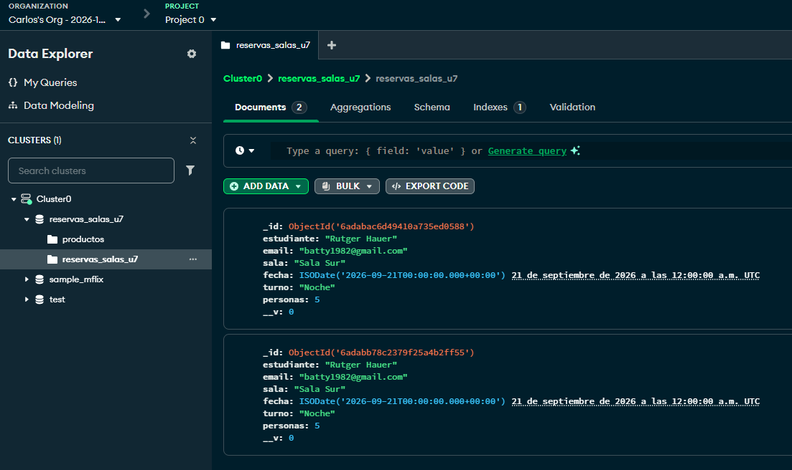

El README debe explicar cómo preparar un clúster Free, un usuario de base con lectura y escritura, la IP permitida y la URI de conexión para Node.js. La instalación local del anexo es material complementario; la evidencia de este TP se obtiene con Atlas.

Conservar el comportamiento de `src/index.js`, `src/app.js`, rutas, controladores, servicio en memoria, middleware, vistas, JSON y recursos previos. Trasladar la función de configuración HTTP a `src/config/entorno.js`, agregar allí el lector de URI y actualizar sus importaciones (incluida la de `src/index.js`) antes de eliminar `src/configuracion.js`. No exigir la URI para arrancar el sitio en memoria. Incorporar archivos con responsabilidades equivalentes a:

Cómo configurar las credenciales de Atlas sin publicarlas.

Qué archivo contiene la configuración y cuál establece la conexión.

Cómo está definido el modelo de reservas.

Cómo ejecutar el programa para crear una reserva.

Cómo ejecutar el programa para consultar las reservas.

Por qué esas operaciones son independientes de las rutas web de Express.

////////////////////////////////////////
TP 07 – Persistencia inicial de reservas de salas

1. Descripción del proyecto
Este proyecto corresponde al Trabajo Práctico 07 del curso de Desarrollo Back-end con Node.js.
El objetivo es incorporar persistencia de datos mediante MongoDB y Mongoose a una aplicación de reservas de salas de estudio desarrollada previamente en el TP 06.
Se trabaja con dos partes independientes:
•	Aplicación web: utiliza Express y conserva el funcionamiento del TP 06. Las reservas creadas desde el formulario continúan almacenándose en memoria.
•	Laboratorio de persistencia: permite comprobar la conexión con MongoDB Atlas, crear reservas y consultar los documentos almacenados mediante programas ejecutados desde la terminal.
En esta etapa no se modifica el servicio HTTP para utilizar MongoDB. La integración de la persistencia con las rutas web queda para una unidad posterior.

2. Tecnologías utilizadas
•	Node.js.
•	Express.
•	MongoDB Atlas Free (M0).
•	Mongoose.
•	JavaScript con módulos CommonJS.
•	Dotenv / variables de entorno mediante --env-file.
•	ESLint.
•	Prettier.
•	EJS, CSS y los demás recursos heredados del TP 06.
Versiones utilizadas en el desarrollo:
•	Node.js: completar con la versión instalada.
•	npm: completar con la versión instalada.
•	MongoDB Atlas: clúster Free (M0).
•	Mongoose: completar con la versión instalada en package.json.
Para consultar las versiones instaladas:
node --version
npm --version
npm list mongoose

3. Estructura del proyecto
La estructura principal del TP 07 es la siguiente:
tp-07-salas-mongodb/
├── src/
│   ├── config/
│   │   ├── entorno.js
│   │   └── base-datos.js
│   ├── modelos/
│   │   └── reserva.js
│   ├── index.js
│   ├── app.js
│   ├── archivos.js
│   ├── configuracion.js
│   ├── rutas/
│   │   └── reservas.js
│   ├── controladores/
│   │   └── reservas.js   
│   ├── servicios/
│   │   └── reservas.js
│   └── ...
├── scripts/
│   ├── comprobar-conexion.js
│   ├── crear-reserva.js
│   └── listar-reservas.js
├── public/
├── views/
├── .env
├── .env.example
├── .gitignore
├── eslint.config.js
├── package.json
├── package-lock.json
└── README.md
Responsabilidades principales
•	src/config/entorno.js: centraliza la lectura de las variables de entorno y la configuración HTTP.
•	src/config/base-datos.js: configura la resolución DNS y administra la conexión con MongoDB.
•	src/configuracion.js: lee y valida la configuración de la aplicación, se usó en la versión anterior.
•	src/archivos.js: lee archivos json y los convierte a objetos.
•	src/modelos/reserva.js: define el esquema y las validaciones del modelo Reserva.
•	scripts/comprobar-conexion.js: verifica la conexión con la base de datos.
•	scripts/crear-reserva.js: crea y guarda una reserva de prueba.
•	scripts/listar-reservas.js: consulta y muestra las reservas persistidas.

4. Instalación y preparación del entorno

4.1. Clonar o descargar el repositorio
Clonar el repositorio individual desde GitHub y ubicarse en su carpeta raíz:
git clone https://github.com/charlyzava/tp7-salas-mongodb
cd tp-07-salas-mongodb

4.2. Instalar las dependencias
npm install
Este comando instala las dependencias declaradas en package-lock.json.

4.3. Configurar MongoDB Atlas
Para utilizar MongoDB Atlas se deben realizar los siguientes pasos:
1.	Ingresar a MongoDB Atlas y crear una cuenta, si todavía no se dispone de una.
2.	Crear un proyecto para el trabajo práctico.
3.	Crear un clúster gratuito de tipo Free (M0).
4.	Crear un usuario de base de datos con permisos de lectura y escritura.
5.	Configurar la lista de direcciones IP permitidas para que incluya la IP pública desde la que se ejecutará la aplicación.
6.	Ingresar a la opción de conexión del clúster y obtener la cadena de conexión para una aplicación Node.js.
7.	Reemplazar los marcadores de la cadena por el usuario, la contraseña y el host correspondientes.
No se deben publicar la contraseña ni la URI privada del clúster.

4.4. Configurar las variables de entorno
renombrar .env.example a un archivo llamado .env. y agregar las credenciales de Atlas al archivo.

La base de datos utilizada para este trabajo práctico se denomina:
reservas_salas_u7

5. Configuración y conexión con MongoDB

La conexión se centraliza en src/config/base-datos.js, evitando repetir su configuración en cada programa.
Antes de iniciar la conexión, el módulo configura los servidores DNS mediante:
dns.setServers(["8.8.8.8", "1.1.1.1"]);
Esta configuración utiliza resolutores DNS públicos para la resolución de nombres. Su aplicación afecta la resolución DNS de Node.js, pero no modifica la autenticación de MongoDB ni la lista de direcciones IP permitidas en Atlas.
Si la red utilizada no permite estos resolutores o requiere otros servidores, se debe registrar el ajuste autorizado que se haya realizado.
La URI se obtiene desde la variable MONGODB_URI. Si está ausente o no tiene el prefijo esperado, la conexión debe informar un error de configuración sin mostrar credenciales.
Prueba de conexión
Desde la raíz del proyecto, ejecutar:
node --env-file=.env scripts/comprobar-conexion.js
El programa debe esperar la confirmación de la conexión antes de anunciar el éxito. No debe crear documentos y debe cerrar la conexión tanto en caso de éxito como de error.
Si se produce un error, se debe registrar el nombre del error, el código DNS cuando corresponda y la operación que falló, sin publicar la URI privada ni la contraseña.

6. Modelo de datos: Reserva
El modelo Reserva representa una solicitud de uso de una sala de estudio y se define mediante Mongoose.
La colección de MongoDB se establece explícitamente como reservas.
Campos y reglas de validación
Campo	Tipo	Reglas
estudiante	String	Obligatorio y sin espacios en los extremos.
email	String	Obligatorio, con eliminación de espacios en los extremos y presencia de @.
sala	String	Obligatorio. Valores permitidos: Sala Norte, Sala Sur o Sala Multimedia.
fecha	String	Obligatorio y no vacío después de eliminar espacios en los extremos.
turno	String	Obligatorio. Valores permitidos: Mañana, Tarde o Noche.
personas	Number	Obligatorio, entero entre 1 y 6 inclusive.
Para implementar estas reglas se utilizan las opciones de validación de Mongoose, como required, trim, enum, min, max, match y un validador personalizado con Number.isInteger.
Las validaciones se ejecutan al guardar los documentos mediante el modelo.
Limitaciones actuales

Estas reglas corresponden al alcance inicial del trabajo práctico. Todavía no se valida de manera completa:
•	La estructura real de una dirección de correo electrónico.
•	La existencia de una fecha válida en el calendario.
•	Que la fecha corresponda al futuro.
•	La disponibilidad de las salas y los cupos compartidos.
•	Los solapamientos entre reservas.
•	La duplicación de solicitudes para una misma persona.
No se exige un índice único para los campos de la reserva.
MongoDB genera un identificador _id de tipo ObjectId para cada documento. Este identificador se utiliza para reconocer las reservas persistidas y se convierte a texto cuando se muestra en la terminal.
La existencia de un _id en un objeto no demuestra por sí sola que los datos se hayan guardado en la base. Para confirmar la escritura, el programa debe esperar el resultado de la operación de guardado y mostrar el identificador después de que esta finalice correctamente.

7. Programas de terminal
Los tres programas se ejecutan desde la raíz del repositorio. Cada uno abre su propia conexión y la cierra al finalizar.
7.1. Comprobar la conexión
node --env-file=.env scripts/comprobar-conexion.js
Comprueba que la configuración y la conexión con MongoDB Atlas funcionen correctamente.
El programa no crea ni modifica reservas. Si ocurre un error, termina con un código de salida distinto de cero.
7.2. Crear una reserva
node --env-file=.env scripts/crear-reserva.js
Crea una reserva ficticia mediante el modelo Reserva y espera la confirmación de la escritura.
Si la operación finaliza correctamente, muestra el _id del documento guardado. Si falla una validación o la conexión, informa el problema sin anunciar una creación exitosa.
Cada ejecución válida puede generar un documento nuevo. Por eso, ejecutar dos veces el programa puede producir dos reservas diferentes aunque sus demás campos sean iguales.
7.3. Listar las reservas
node --env-file=.env scripts/listar-reservas.js
Consulta todos los documentos de la colección reservas y muestra un listado legible con sus identificadores y campos principales.
Al finalizar informa la cantidad total recuperada.
Si la colección está vacía, el programa debe terminar correctamente y mostrar una cantidad de cero. La consulta no crea, modifica ni elimina documentos y no utiliza los datos almacenados en memoria por la aplicación web.
8. Evidencia de persistencia
Para comprobar que los datos permanecen guardados entre distintas ejecuciones, se realiza el siguiente ensayo en la base individual de MongoDB Atlas.
1.	Ejecutar el programa de listado y registrar la cantidad inicial de documentos.
2.	Ejecutar el programa de creación y anotar el _id que devuelve.
3.	Esperar a que el proceso termine.
4.	Abrir una nueva ejecución de Node.js y ejecutar nuevamente el programa de listado.
5.	Comprobar que aparece el mismo _id y que la cantidad de documentos aumentó en uno.
6.	Ejecutar el listado una tercera vez y verificar que la cantidad permanece igual, siempre que no se hayan producido otras escrituras.
7.	Ingresar a MongoDB Atlas, abrir Data Explorer y localizar la base reservas_salas_u7, la colección reservas y el documento identificado por ese _id.
Registro del ensayo
Completar esta tabla con los resultados obtenidos durante la ejecución real.
Ejecución	Cantidad observada	_id o evidencia
Listado inicial	Pendiente	Pendiente
Creación de reserva	Pendiente	Pendiente
Listado desde otro proceso	Pendiente	Pendiente
Segundo listado posterior	Pendiente	Pendiente
Capturas que se deben adjuntar
•	Captura de la terminal con la cantidad inicial.
•	Captura de la creación con el _id confirmado.
•	Captura de una nueva ejecución que recupera ese mismo _id.
•	Captura del segundo listado que demuestra que no se agregaron registros adicionales.
•	Captura de MongoDB Atlas Data Explorer con la base, la colección y el documento correspondiente.
Las capturas deben permitir relacionar el documento guardado en Atlas con el resultado obtenido desde la terminal. No deben mostrar credenciales ni información personal real.
9. Matriz de pruebas
La siguiente matriz debe completarse con el resultado observado. No se deben marcar como exitosos los casos que todavía no se ejecutaron.
Caso	Resultado esperado	Resultado observado
Conexión válida	Confirma la conexión y termina el proceso.	Pendiente
Fallo DNS, si ocurre	Informa el código y la operación; permite documentar el diagnóstico.	Pendiente / No ocurrió
Variable MONGODB_URI ausente	Informa un error de configuración y no anuncia éxito.	Pendiente
Contraseña incorrecta temporal	Falla la autenticación sin crear documentos.	Pendiente
Colección vacía, si se dispone de una base nueva	Muestra cantidad 0 y termina correctamente.	Pendiente / No disponible
Reserva válida	Guarda el documento y devuelve su _id.	Pendiente
Consulta desde otro proceso	Recupera el mismo _id.	Pendiente
Segunda consulta	Mantiene la cantidad de documentos sin otras escrituras.	Pendiente
Estudiante vacío	Rechaza la reserva y no modifica la cantidad.	Pendiente
Email sin @	Rechaza la reserva y no modifica la cantidad.	Pendiente
Sala no permitida	Rechaza la reserva y no modifica la cantidad.	Pendiente
Turno no permitido	Rechaza la reserva y no modifica la cantidad.	Pendiente
Fecha vacía	Rechaza la reserva y no modifica la cantidad.	Pendiente
Personas igual a 0	Rechaza la reserva.	Pendiente
Personas igual a 7	Rechaza la reserva.	Pendiente
Personas igual a 2.5	Rechaza la reserva.	Pendiente
Personas con texto no numérico	Rechaza la conversión o la validación, sin escritura.	Pendiente
Para los casos inválidos, se modifica temporalmente un solo campo del objeto de prueba, se ejecuta el programa y se comprueba que la cantidad de documentos no aumente. Después se restaura la reserva válida.
Para comprobar un error de autenticación, se modifica temporalmente la contraseña en el .env privado por un valor incorrecto, sin cambiar la contraseña del usuario en Atlas. Después se restaura la URI correcta y se repite la conexión.
No se deben borrar documentos para conseguir una colección vacía. Si la base ya contiene registros, se debe documentar esa situación.
10. Calidad del código
El proyecto conserva las herramientas de calidad utilizadas en el TP 06 y amplía su alcance para incluir los programas de terminal.
Ejecutar desde la raíz:
npm run format
npm run check
Los scripts deben aplicar Prettier sobre src y scripts, verificar el formato con prettier --check y ejecutar ESLint sobre ambas carpetas.
Los nombres exactos de los scripts dependen de la configuración de package.json.
También se debe comprobar que eslint.config.js incluya los archivos JavaScript de ambas ubicaciones, sin eliminar las reglas existentes para ocultar errores.
Registrar los resultados observados:
•	npm run format: pendiente de ejecución.
•	npm run check: pendiente de ejecución.
11. Continuidad de la aplicación web
La aplicación web debe conservar el comportamiento funcional del TP 06.
Ejecutar:
npm start
Comprobar los siguientes puntos:
•	La página de inicio continúa disponible.
•	La ruta /estado responde correctamente.
•	El listado de reservas funciona.
•	El formulario válido conserva su redirección y crea una reserva en memoria.
•	El formulario inválido devuelve el estado HTTP 400 y no crea una reserva.
•	Los recursos CSS continúan funcionando.
•	Las rutas inexistentes muestran la respuesta 404 prevista.
En esta etapa, las reservas del laboratorio de MongoDB no tienen por qué aparecer en las vistas web. Las reservas creadas mediante los formularios siguen siendo independientes de los documentos guardados desde los programas de terminal.
Registrar el resultado de esta comprobación antes de entregar.
12. Diferencias entre memoria y persistencia
En el TP 06, las reservas se guardan en una estructura de datos en memoria. Esta información no constituye una persistencia permanente y puede perderse al reiniciar el proceso de Node.js.
En el TP 07, las reservas del laboratorio se almacenan en MongoDB Atlas. Los documentos permanecen disponibles después de finalizar el programa y pueden recuperarse desde otra ejecución.
Esta separación permite aprender a conectar una aplicación Node.js con una base de datos sin alterar todavía el funcionamiento de los controladores y servicios existentes.
En la unidad 8 se podrá abordar la integración de MongoDB con el servicio HTTP para que las operaciones de la aplicación web trabajen con datos persistentes.
13. Seguridad y buenas prácticas
•	No subir el archivo .env a GitHub.
•	No publicar contraseñas, URI privadas ni otros secretos.
•	Mantener .env.example con marcadores de ejemplo.
•	No subir node_modules ni la carpeta .git.
•	Utilizar datos ficticios en las pruebas.
•	Evitar capturas que expongan credenciales o información personal.
•	Mantener package-lock.json en el repositorio para facilitar la instalación reproducible.
•	Si se expusieron credenciales accidentalmente, reemplazarlas antes de considerar segura la entrega.
14. Conclusión
Este trabajo práctico incorpora una primera experiencia de persistencia con MongoDB y Mongoose al proyecto de reservas de salas de estudio.
Se organiza la configuración de la conexión, se define un modelo con validaciones, se crean programas independientes para guardar y consultar documentos y se establece un procedimiento reproducible para verificar la persistencia entre procesos.
La aplicación web del TP 06 conserva su funcionamiento original, lo que permite diferenciar el almacenamiento en memoria de la persistencia en una base de datos externa.
15. Lista de verificación antes de entregar
•	 
El repositorio corresponde a tp-07-salas-mongodb.
•	 
Se incluye el código del TP 06 y el laboratorio del TP 07.
•	 
Se incluye package.json y package-lock.json.
•	 
Se incluye .env.example y .env está excluido de Git.
•	 
El README explica cómo preparar MongoDB Atlas Free (M0).
•	 
La conexión se comprueba sin crear documentos.
•	 
La creación devuelve el _id de una escritura confirmada.
•	 
El listado recupera documentos de ejecuciones anteriores.
•	 
Se realizaron y registraron las pruebas negativas.
•	 
Se adjuntó evidencia de persistencia desde terminal y Atlas.
•	 
Prettier y ESLint se ejecutaron sobre las carpetas correspondientes.
•	 
La aplicación web conserva el comportamiento del TP 06.
•	 
Se completaron las versiones utilizadas y los resultados observados.
•	 
No se publicaron credenciales ni datos personales.

#El README debe explicar cómo preparar un clúster Free, un usuario de base con lectura y escritura, la IP permitida y la URI de conexión para Node.js

Crear cuenta en 
https://www.mongodb.com/es

Nombrar un cluster, por defecto Cluster0

Por defecto se agrega la dirección ip actual, se genera un nombre de usuario y password, con posibilidad de descargar un archivo .env

Si no descargamos el archivo env lo podemos crear y escribir en el archivo:
PORT=3000
NODE_ENV=development
MONGODB_URI=<aqui pegar linea de mongodb>

donde pegaremos la línea con las credenciales y el host.

Es muy importante agregar el archivo en .gitignore para no comprometer la seguridad del cluster.

Seleccionamos un método de conexión

